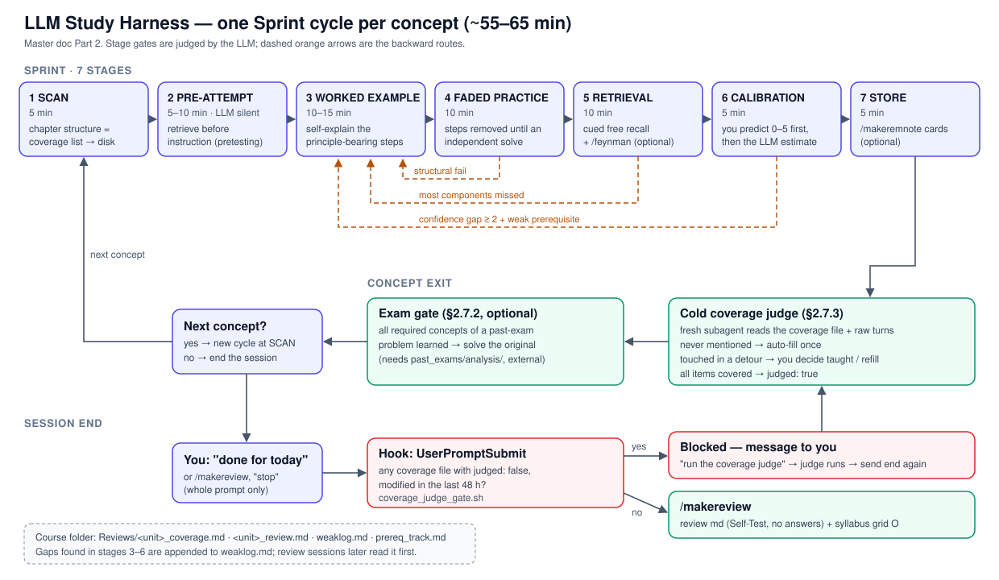
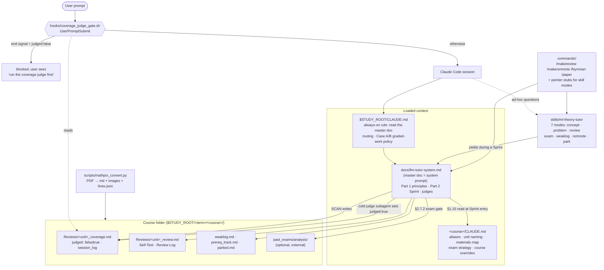

# LLM Study Harness

[](https://github.com/Sungho-Park-DE/llm-study-harness/actions/workflows/ci.yml)

A Claude Code setup that turns the assistant into a structured 1:1 tutor for university theory courses. It is built from prompt documents, a skill, slash commands and one hook. I built and used it during one semester (TUM, 2026 summer term, four courses: deep learning, foundation models, data-analysis math, cloud data processing).

What you get:

- A **7-stage learning cycle** per concept: SCAN → pre-attempt → worked example → faded practice → retrieval → calibration → store. Each stage has gates and stage tags, and failures route back to earlier stages.
- **Learning-protection rules** that apply in every mode: no praise, tiered hints instead of answers, no ready-made notes to copy, and a guard against doing graded homework for you.
- **Persistent study state** as plain markdown in each course folder: a coverage list per unit, review sheets, a weak-spot log, a prerequisite queue and parked concepts.
- A **cold coverage judge**: a fresh subagent checks at each concept exit whether every item of the unit was actually taught. A hook stops a session from ending while a unit is still unjudged.
- An **exam gate**: if a course folder holds structured past-exam data (`past_exams/analysis/`, produced outside this repo), original exam problems unlock once all their concepts are learned.

## Workflow



A PNG copy for slides and documents is in `docs/workflow.png`.

## Architecture



Precedence when files disagree, highest first, defined in the master doc Part 1: graded-work Case B, then a course rule that names the master section it replaces, then the master doc, then course patterns, then skill defaults.

## Design rationale

**Learning-science basis.** Each rule in the master doc carries its source inline. The main ones:

| Mechanism in the harness | Key sources | What the evidence supports, and what is a design choice |
|---|---|---|
| Stage 2 pre-attempt before instruction | Richland, Kornell & Kao 2009; Kornell, Hays & Bjork 2009; Sinha & Kapur 2021; Ashman, Kalyuga & Sweller 2020 | Pretesting helps even when wrong; problem solving before instruction has a moderate edge (g = 0.36) but can reverse for complex material, so Stage 2 stays a short diagnostic |
| Self-explanation at principle-bearing steps; fluency lowers cue strength, not demand | Bisra et al. 2018; Renkl 1997; Atkinson, Renkl & Merrill 2003; Leppink et al. 2012 | Prompted self-explanation g = .55; quality predicts gains. No study isolates per-step prompt density, so selectivity is a design inference |
| Compressed entry after a correct pre-attempt, re-probed at once | Kalyuga et al. 2003; Kalyuga & Sweller 2004; Salden et al. 2010 | Expertise reversal; rapid diagnostics track expertise (r up to .92) but were re-run at every stage, hence the re-probe |
| Worked-example comparison, principle stated afterwards | Alfieri, Nokes-Malach & Schunn 2013; Gentner, Loewenstein & Thompson 2003 | Case comparison d ≈ 0.50; a principle after comparison raises gains |
| Proof mode: line-by-line explanation, heuristic first example | Hodds, Alcock & Inglis 2014; Reiss et al. 2008; Mejia-Ramos et al. 2012 | Self-explanation training d ≈ 0.95; two of the three proof prompts come from an assessment model, and the proof fading ladder is untested |
| Calibration: user predicts first; feedback is the observed result | Yang, Sun & Shanks 2018; Callender et al. 2016; Gutierrez & Schraw 2015; Bol et al. 2005 | Anchors shift judgments; calibration improves with feedback on actual performance, not with prediction practice alone |
| Confirmation names the strategy, never the person | Hattie & Timperley 2007; Wisniewski, Zierer & Hattie 2020; Kluger & DeNisi 1996; Amemiya & Wang 2018 | Self-level praise carries little information; high-information feedback d = 0.99 |
| High-confidence errors re-tested at once and next session | Butterfield & Metcalfe 2001; Butler, Fazio & Marsh 2011; Metcalfe & Miele 2014 | Hypercorrected errors can return after a delay; an immediate re-test blocks that |
| A weak spot resolves after successes in two sessions on different days | Rawson & Dunlosky 2011; Vaughn, Dunlosky & Rawson 2016; Rawson et al. 2018 | Successive relearning: one correct recall per session, durability from several sessions (the papers recommend three) |
| Review ladder: advance on success, hold after a failure with feedback | Finley et al. 2011; Rowland 2014; Kornell, Klein & Rawson 2015; Pashler et al. 2005 | Diminishing cues help; with feedback, failed retrieval still pays off |
| Interleaved multi-unit practice with unit labels hidden | Rohrer et al. 2015, 2020; Brunmair & Richter 2019; Foster et al. 2019 | Interleaved math d ≈ 0.8 in classroom RCTs; the mechanism is contested and no study isolates label hiding |
| Variant drills near→far, adaptive | Pan & Rickard 2018; Likourezos, Kalyuga & Sweller 2019; Barnett & Ceci 2002 | Transfer needs feedback and accuracy; low variability first suits novices; "distance" is a heuristic |
| /feynman voice-first, with building questions | Kobayashi 2019; Lachner, Jacob & Hoogerheide 2021; Roscoe & Chi 2007 | Explaining helps orally (g = 0.34), not in writing; tutors drift into knowledge-telling without questions |
| Unassisted solo blocks; mock exams with mandatory review | Bastani et al. 2025; Rowland 2014; Adesope et al. 2017; Zhang, Morphew & Stelzer 2023 | AI-assisted gains did not carry over to unassisted exams; feedback roughly doubles the testing effect; a mock alone did not improve metacognition |
| Cold coverage judge on concept-scoped raw turns, user evidence required | Huang et al. 2024; Panickssery, Bowman & Feng 2024; Liu et al. 2023 | Self-correction fails without external evidence; same-model judges favour their own text; long inputs degrade recall |

Every citation was checked against its abstract or full text (2026-10). Where the evidence went against a rule, the rule was changed; where a rule goes beyond its sources, the doc says so. A few details behind paywalls are marked unverified in the doc. This is still a single-user design: none of these rules has been tested as a system.

**Why a cold judge plus a hook.** In a long tutoring session the main context drifts: it compresses what was covered and stops noticing what was skipped. So coverage is checked by a **fresh subagent** that reads two things from disk: the coverage list written at SCAN time, before any drift, and the raw dialogue turns, never a summary written by the main session. The doc records an informal stress test in which a summary-based handoff made the judge flag 16 items against 3 real gaps (§2.7.3). The judge reads only the exiting concept's turns, and an item counts as taught only when a user turn engages it, because a same-model judge still favours its own explanations. Prompt-level rules can be forgotten, so the stop condition is backed by a `UserPromptSubmit` hook. A session-end message such as "done for today", "stop" or `/makereview` is blocked while any recent coverage file still says `judged: false`. A blocked prompt never reaches the model, so the hook's message tells the *user* to ask for the judge first.

## Install

Requirements: Claude Code; `bash`; `jq` or `python3` for the hook; Python ≥ 3.9 (stdlib only) and a Mathpix API key for PDF conversion. Tested on macOS only.

```bash
git clone <this repo> ~/dev/llm-study-harness && cd ~/dev/llm-study-harness
./install.sh            # dry run: shows the symlinks it would create in ~/.claude
./install.sh --apply    # create them (existing non-symlink files are left alone)
```

Then:

1. Merge `settings.example.json` into `~/.claude/settings.json` and point `STUDY_ROOT` at the folder that holds your term folders (`$STUDY_ROOT/<term>/<course>/`).
2. Copy `templates/study-root-CLAUDE.md` to `$STUDY_ROOT/CLAUDE.md`, and `templates/course-CLAUDE.md` into each course folder. Fill in the placeholders. Aliases and unit naming are set per course.
3. Optional, for PDF conversion: `cp scripts/.env.example scripts/.env`, add your keys, then run `python3 scripts/mathpix_convert.py <pdf-or-dir> --dry-run`.
4. Start a session inside a course folder and say, for example, "let's study I2DL this week".

Checks: `bash tests/test_coverage_gate.sh` (hook behavior) and `python3 tests/check_repo.py` (frontmatter, § references, repo paths, privacy guard; needs `pyyaml`). CI runs both on Ubuntu and macOS, plus shellcheck, on every push.

## Repository layout

```
docs/llm-tutor-system.md     master doc (the system prompt), ~800 lines
docs/workflow.svg|png        workflow diagram
skills/ml-theory-tutor/      ad-hoc tutoring modes
commands/                    /makereview /makeremnote /feynman /paper + mode stubs
hooks/coverage_judge_gate.sh session-end gate
tests/                       hook tests + static repo checks
.github/workflows/ci.yml     CI (Ubuntu + macOS)
evals/trigger-cases.md       skill trigger cases (not yet run)
scripts/                     Mathpix conversion + diagram OCR summary
templates/                   study-root and course CLAUDE.md
```

## Limitations

- **No learning-outcome data.** The harness encodes evidence-based techniques, but I have not measured whether it improves learning, retention or grades for me or anyone else. There was no control condition and nothing was logged for evaluation.
- **Not included on purpose.** The past-exam extraction pipeline, course materials (slides, sheets, solutions, exams) and personal study data (coverage files, reviews, weak-spot logs) stay out of this repo.
- **One user, one term.** It was designed and tuned by one person, for one program, and originally used in Korean with English technical terms. This repo is an English translation; the translated prompts and trigger phrases have not been used in real sessions.
- **Mostly prompt-enforced.** Apart from the coverage hook, every rule depends on the model following a long document. Compliance was not measured.
- **Skill triggering is unverified.** The rewritten skill descriptions and the `/tutor-review` rename are based on reading, not on runs. See `evals/trigger-cases.md`.
- **Hook caveats.** `UserPromptSubmit` receives a slash command as typed (`/makereview W03`), not the expanded text. This is documented in the Claude Code hooks reference; I have not tested it in a live session. Coverage files left unjudged for more than 48 h are skipped by design, so such orphans need manual cleanup.
- **The master doc grew by accretion.** It carries dated decisions such as "2026-06-12" and examples from four specific courses. It reads as a working document, not a polished spec.

## License

MIT, see [LICENSE](LICENSE).
